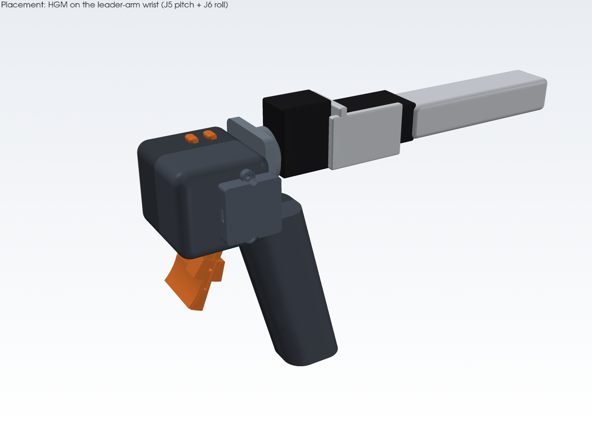
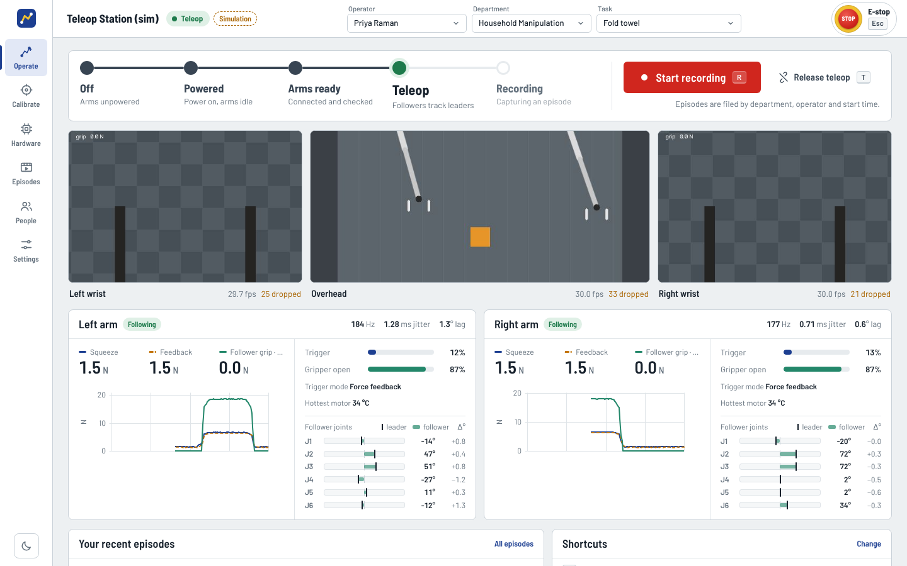
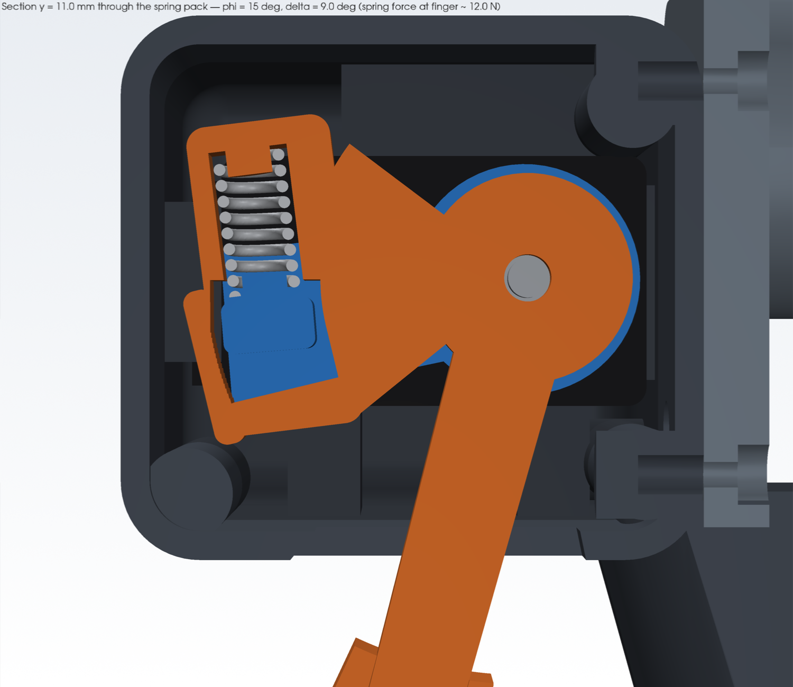
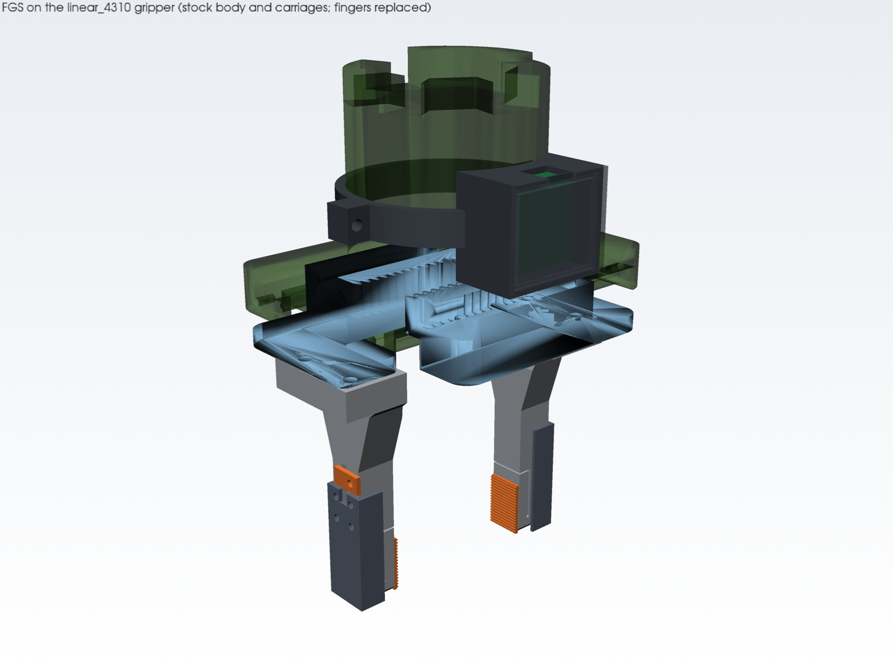
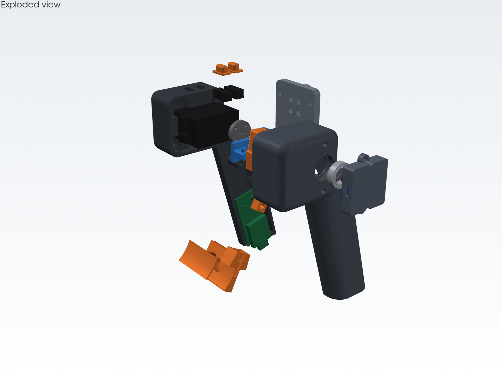
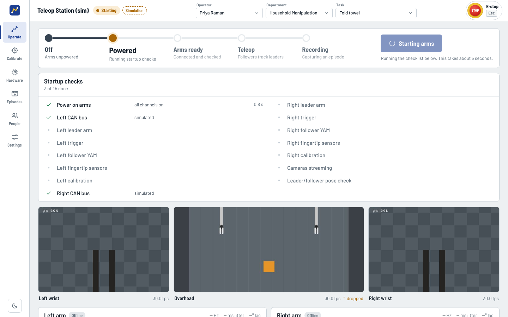
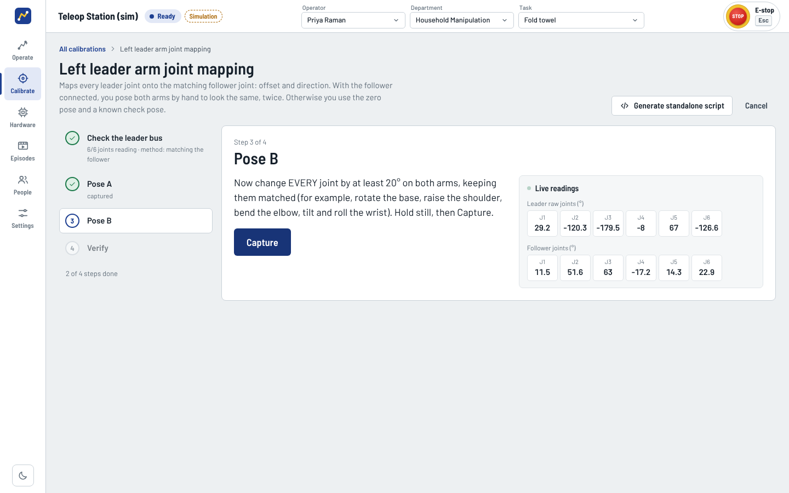
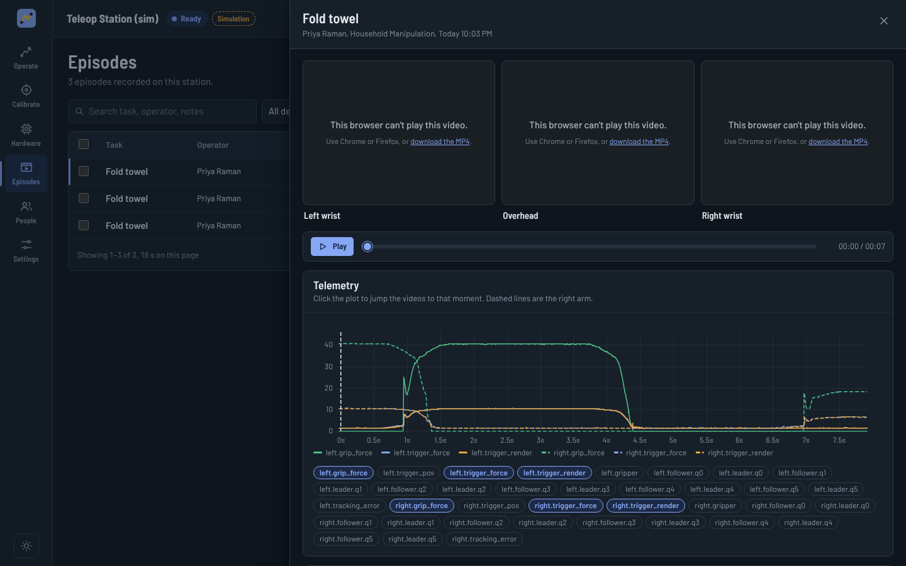
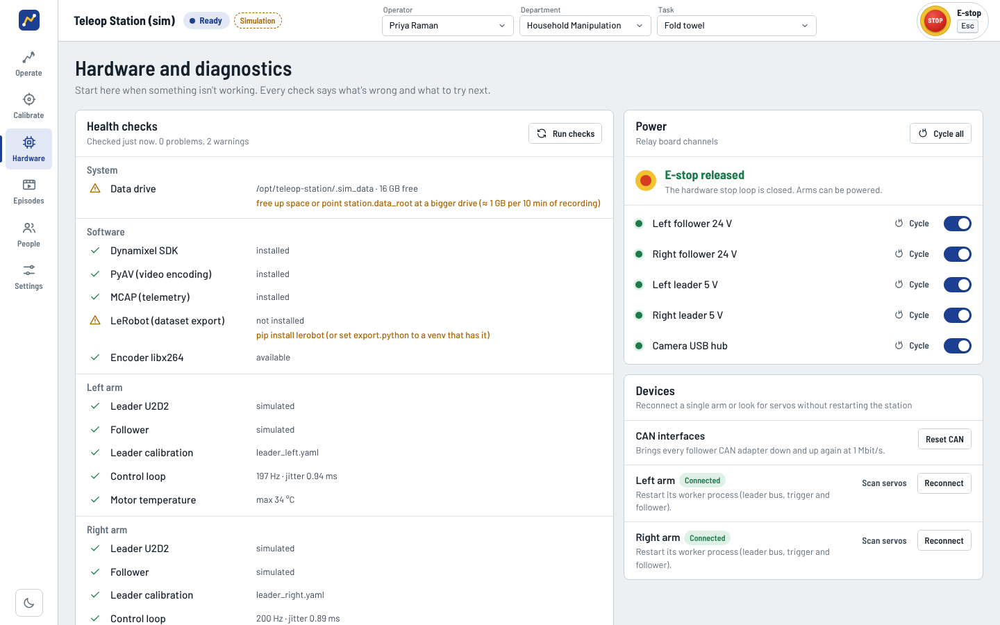

# Teleop Station

**Hand-like bimanual teleoperation for I2RT YAM arms.** The operator feels what the robot's
fingers feel, grips every object with exactly the force it needs, and every one of those
choices is recorded as training data.

Two lightweight leader arms drive two I2RT YAM followers. Each leader handle carries a
**haptic grip trigger** that both measures how hard the operator squeezes and pushes back
with the force the follower is applying, measured by **force-sensing fingertips** on the
follower gripper. Three cameras and 200 Hz arm telemetry are captured in sync, filed by
department, operator and task, and exported as training-ready LeRobot datasets. One web
application runs the whole cell: people, calibration, power, safety, recording and review.

|  |  |
|---|---|
| *Haptic grip trigger on the leader wrist* | *Operate view: cameras, live grip force and feedback per arm* |

---

## Design intent

* **Never limit the robot, make it precise.** The grippers and arms keep their full
  capability. A full squeeze uses the gripper's full force; a gentle squeeze holds gently.
  Precision comes from feel, the way a hand or a beak handles an egg and a rock differently.
* **Feel it like a hand.** Human grip sense has two channels: *sustained pressure* ("how
  hard am I holding this?") and *fast touch* (the instant of contact, the start of a slip).
  The trigger reproduces both, driven by forces measured at the follower's fingertips.
* **Record the intent, not just the motion.** The operator's chosen grip force, the force
  at each fingertip, slip events and the operator's own finger force are all part of every
  episode. Policies trained on this data learn *how hard* to grip, not just when to close.

---

## The haptic grip system

### 1. Haptic grip trigger (leader handle)

A series-elastic trigger: a Dynamixel XC330 servo drives the trigger lever through a
preloaded spring. A magnetic encoder on the lever and the servo's own encoder measure the
spring's compression, which gives the **operator's squeeze force directly**, with no gear
friction in the measurement. The same spring turns the servo's precise position control
into precise **force output**, so the trigger pushes back with the follower's grip force.
A small linear resonant actuator in the finger pad adds the **fast-touch channel**: a crisp
tap on contact, a buzz while an object slips, a tick on release.

| | |
|---|---|
| Force sensing | ≈ 0.1 N per encoder count, 500 Hz telemetry, local force loop at 1 kHz |
| Force rendering | up to 15 N at the finger (12 N default), closed-loop through the spring |
| Spring | music wire, 7.86 N/mm at 20 mm → k_θ = 3.14 N·m/rad; hard overload stop before solid |
| Touch cues | LRA + DRV2605L: contact tap, slip buzz, release tick |
| Electronics | XIAO RP2040, half-duplex Dynamixel bus, AS5600, USB-C to the station |
| Mass / cost | ≈ 130 g · ≈ $87 per handle |

Why series-elastic and not a load cell, pressure pad or direct-drive motor: see the trade
study in [docs/hardware/haptic-trigger.md](docs/hardware/haptic-trigger.md) §2.



### 2. Force-sensing fingertips (follower gripper)

Replacement fingertips for the I2RT `linear_4310` gripper, each with a strain-gauge load
cell under a compliant grip pad, read by a simultaneous 24-bit ADC. They report the **true
contact force at each jaw** and a high-frequency **slip band** that picks up stick-slip
before the object visibly moves. With them, everything the operator feels, and every
force-control decision, is based on the force actually pressing on the object rather than
an estimate from motor current. Full write-up:
[docs/hardware/fingertip-sensor.md](docs/hardware/fingertip-sensor.md).

| | |
|---|---|
| Fit | bolts to the stock finger interface with the stock M4 screws; contact face, tip position and stroke unchanged |
| Structure | one-piece 7075-T6 aluminium flexure finger; elastic up to the gripper's stall force (no overload stop to adjust) |
| Sensing | full-bridge strain gauges, ADS131M02 24-bit ADC, 0.03 N rms force noise at 500 Hz |
| Stiffness | 4.3 kN/mm (stiffer than the jaws themselves), first mode 4.6 kHz |
| Slip band | high-frequency strain energy, noise floor ≈ 0.05 N |
| Mass / cost | +55 g per gripper · ≈ $267 per gripper |



### 3. How force flows

```
 operator's finger                                                     object
      │  squeeze depth past contact ──▶ grip-force command ──▶ follower gripper ──┐
      │                                                                          │
      │                                     fingertip load cells ◀───────────────┘
      │                                      │ pressure          │ contact / slip
      ◀── trigger push-back (natural feel) ◀─┘                   │
      ◀── tap · buzz · tick (vibration) ◀────────────────────────┘
```

* **Squeeze sets force.** Until the jaws touch, the gripper follows the trigger. After
  contact, how far you squeeze sets grip force, from a light hold up to the gripper's full
  force at a full squeeze. It works the way squeezing harder works for a hand, and it never
  asks the trigger to render the gripper's stiff position servo, so it stays stable.
* **Natural feel.** People sense force ratios, not newtons, so feedback follows a power
  law (≈ force^0.6). Light holds are clearly felt and the gripper's full range still fits
  the trigger:

  | follower grip | 2 N | 5 N | 10 N | 20 N | 35 N |
  |---|---|---|---|---|---|
  | felt on the trigger | 2.2 N | 3.1 N | 4.7 N | 7.0 N | 9.7 N |

* **Stable and safe by construction.** Spring compliance plus damping keep the loop
  passive. A 100 ms watchdog drops the trigger to a passive spring if the station goes
  silent. Any fault holds the follower and relaxes the trigger.

Control details and tuning: [docs/haptics-control.md](docs/haptics-control.md).

### 4. Build package for the mechanical team

Start at **[docs/hardware/README.md](docs/hardware/README.md)**: what to print, what to buy,
and the order to assemble it in.

| What | Where |
|---|---|
| Trigger CAD: parametric source (every dimension in one file) | `hardware/cad/params.py`, `hardware/cad/parts/` → `python hardware/cad/build.py` |
| Trigger STEP (per part and assembly), print-oriented STL | `hardware/cad/out/step/`, `hardware/cad/out/stl/`, `hardware/cad/out/hgm_assembly.step` |
| Fingertip CAD, STEP/STL, FEA | `hardware/cad/fgs/` → `python hardware/cad/fgs/fgs_build.py`, outputs in `hardware/cad/fgs/out/` |
| Interactive 3D viewer (explode, toggle parts) | `hardware/cad/viewer/index.html` (open in a browser) |
| Renders: assembly, exploded, sections, travel, placement | `hardware/cad/out/renders/`, `hardware/cad/fgs/out/renders/` |
| Design checks: interference, wall thickness, spring and flexure stress, mass | `hardware/cad/out/checks.md`, `hardware/cad/fgs/out/checks.md` |
| Critical dimensions, fits and tolerances | [haptic-trigger.md](docs/hardware/haptic-trigger.md), [fingertip-sensor.md](docs/hardware/fingertip-sensor.md) §10 |
| Schematics, pinouts, protoboard layout | `hardware/electronics/` |
| Bill of materials with suppliers and prices | [docs/hardware/bom.md](docs/hardware/bom.md) |
| Firmware (PlatformIO) and prebuilt UF2 images | `hardware/firmware/` |
| Assembly guide, electronics and wiring | [docs/hardware/assembly-guide.md](docs/hardware/assembly-guide.md), [docs/hardware/electronics.md](docs/hardware/electronics.md) |



---

## The station system

```
                     ┌──────────────────────── Station PC (Ubuntu) ────────────────────────┐
 Leader arm ── U2D2 ─▶ ArmWorker (own process, 200 Hz)                                     │
 Grip trigger ─ USB ─▶   map → limits → engage / track → force coupling → haptics  ─ CAN ─▶ YAM follower
 Fingertips ─── USB ─▶                                                              ◀──── q, τ, grip
 3 cameras ──── USB ─▶ CameraWorker ×3 (own processes, 30 Hz, H.264)                       │
 Relay + e-stop ◀────  PowerManager                                                        │
                     │ Orchestrator: state machine · startup checks · calibration · recorder │
                     │ FastAPI + WebSocket + MJPEG  ──▶  web UI (any browser on the network) │
                     └──────────────────────────────────────────────────────────────────────┘
```

| Area | What it does |
|---|---|
| **Teleoperation** | One 200 Hz control process per arm, isolated from the web server and video encoding. Leader → follower joint mapping from calibration. Engaging eases the follower onto the leader with a minimum-jerk ramp (never a jump). Velocity and joint-limit clamps. Tracking-error, stale-bus and lost-device faults. A fault on either arm stops both. Workers park the arm if the server dies. |
| **Recording** | One key, handle button or foot pedal starts all cameras and both arms together. Episodes are written crash-safe to staging, then committed atomically as `recordings/<department>/<operator>/<timestamp>_<task>/`: MCAP telemetry at 200 Hz (opens in Foxglove), H.264 video per camera, per-frame capture timestamps, and a metadata file with calibration and settings snapshots. Abort deletes the take. A fault mid-take saves it, tagged. |
| **Force data** | Every take records the operator's grip-force command, fingertip forces, slip and touch events, the operator's finger force and the rendered feedback. Each episode gets a grip summary (peak and mean contact force, contact time, slip time). |
| **Datasets** | Select episodes → export a **LeRobot v3.0** dataset (written by the `lerobot` library). Action = joints + gripper + **grip-force command**. Observations include fingertip forces, slip, effort and haptics. Per-episode camera-sync statistics and provenance (operator, department, task, outcome). |
| **Calibration** | Guided wizards: leader joint mapping (detects reversed servos automatically), trigger travel/zero/stiffness, follower grip force, fingertip load cells, camera intrinsics (ChArUco). Each one can also generate a **standalone script** with this station's ports baked in. |
| **Power and safety** | USB or Ethernet relay boards switch each arm's power. The hardware e-stop cuts the switching loop directly and is sensed by the station. Power-cycling parks the arm first. Software e-stop on `Esc`. |
| **People and data** | Departments, operators and tasks (no passwords; the station PCs are access-controlled). Every episode is attributed, searchable, reviewable with synced video and telemetry, and taggable as success or failure. |
| **Diagnostics** | `station doctor` and the Hardware page: every check reports what's wrong and how to fix it (ports, permissions, USB latency, CAN state, camera rate, relay, e-stop, loop rate, motor temperature). Live logs from every process. |

|  |  |
|---|---|
| *Start Arms: each check with its result and fix* | *Calibration: leader-arm joint mapping* |
|  |  |
| *Episode review: telemetry synced to video* | *Health checks, power relays, e-stop, devices* |

---

## Getting started on the real cell

```bash
bash scripts/setup_ubuntu.sh   # Python env, I2RT SDK, LeRobot, udev rules, CAN permissions, web UI
# edit config/station.yaml (every CHANGE_ME), then:
station doctor                 # checks every device and tells you how to fix what's wrong
station serve                  # open http://<station-pc>:8000
```

Bring-up order, PC requirements and the configuration reference:
[docs/getting-started.md](docs/getting-started.md). Daily use:
[docs/operator-guide.md](docs/operator-guide.md).

### Try it without hardware

Every device has a simulated twin, so the full application runs on any Linux, macOS or
Windows machine for training and development:

```bash
python3 -m venv .venv && source .venv/bin/activate && pip install -e ".[dev]"
station serve --sim
```

---

## Documentation

| | |
|---|---|
| [Hardware: start here](docs/hardware/README.md) | the mechanical team's entry point |
| [Haptic grip trigger](docs/hardware/haptic-trigger.md) | requirements, trade study, mechanism, calculations, control, verification |
| [Fingertip sensors](docs/hardware/fingertip-sensor.md) | sensor design, calculations, slip sensing, calibration |
| [Electronics](docs/hardware/electronics.md) | trigger and fingertip boards, station power, relays, e-stop |
| [Haptic control](docs/haptics-control.md) | force law, natural-feel mapping, touch cues, stability, tuning |
| [Architecture and API](docs/architecture.md) | processes, state machine, REST/WebSocket contract |
| [Getting started](docs/getting-started.md) · [Operator guide](docs/operator-guide.md) | setup and daily use |
| [Calibration](docs/calibration.md) · [Data format](docs/data-format.md) | the math behind each wizard; episode and dataset layout |
| [Troubleshooting](docs/troubleshooting.md) · [Development](docs/development.md) | symptom → fix; code tour and tests |
| [Device protocol](docs/protocol/haptic-protocol.md) | wire format shared by the station and both firmwares |

## Repository layout

```
hardware/   cad/ (parametric source, STEP/STL, drawings, renders, viewer) · electronics/ · firmware/
station/    the station software (Python): control workers, drivers, recorder, calibration, API
ui/         the web application (React + TypeScript)
config/     station.yaml (your cell) · station.sim.yaml (simulation)
docs/       design reports, guides, protocol
scripts/    PC setup, udev rules, systemd service
tests/      unit, integration and end-to-end tests
```

## Status

| | |
|---|---|
| Station software | Tested end to end against simulated devices (unit, integration and end-to-end suites) |
| LeRobot export | Verified with `lerobot` 0.6.1: dataset v3.0 written and loaded back |
| YAM followers | Uses the I2RT SDK (v1.3.6 API); first run on the arms pending |
| Leader arms | Dynamixel Protocol 2.0; servo IDs and baud rate set in the config |
| Haptic grip trigger and fingertips | Designed, analysed (FEA, stress, fatigue, noise budgets) and interference-checked against the stock gripper; both firmwares compile and pass host tests (169 + 102); first build pending. Confirm the items marked `VERIFY` against your parts before manufacturing. |

Built on the [I2RT](https://github.com/i2rt-robotics/i2rt) YAM SDK and
[LeRobot](https://github.com/huggingface/lerobot); the leader-arm concept follows
[GELLO](https://wuphilipp.github.io/gello_site/). Software: MIT. Hardware designs: CERN-OHL-P-2.0.
