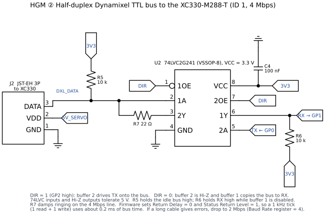
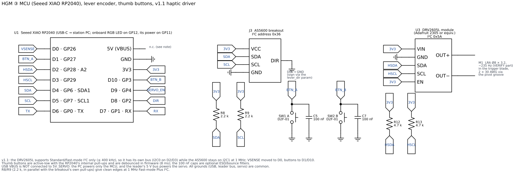
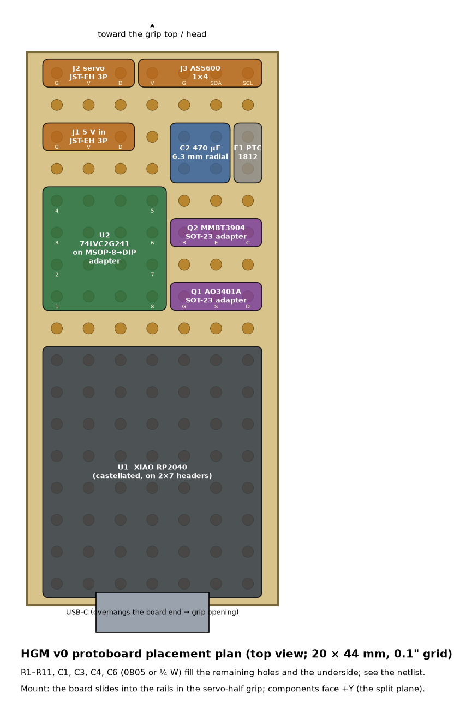
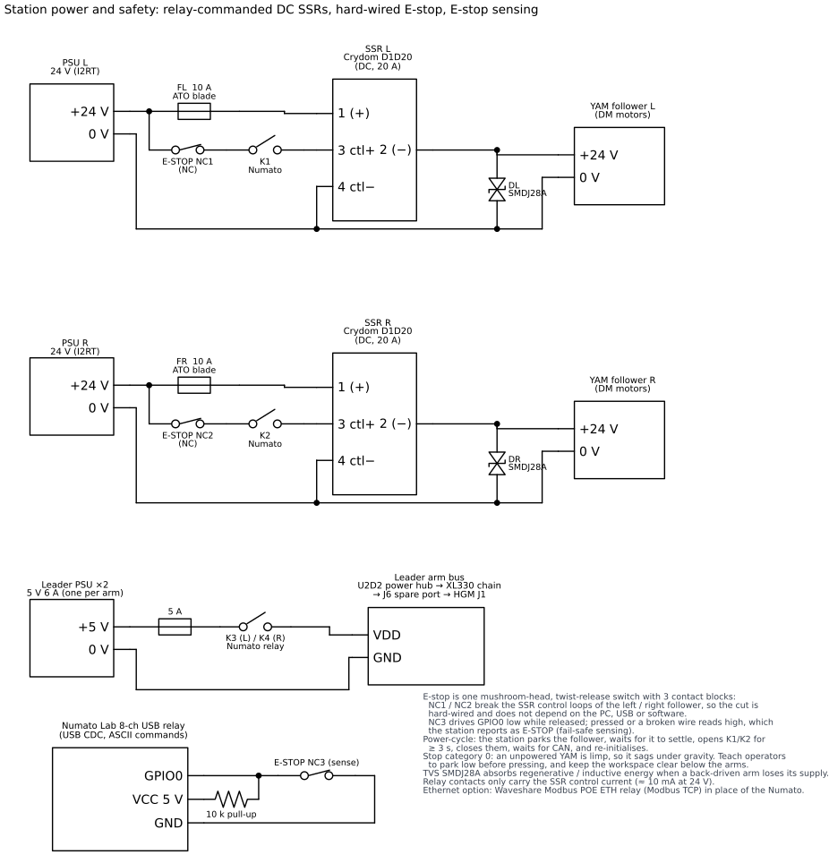
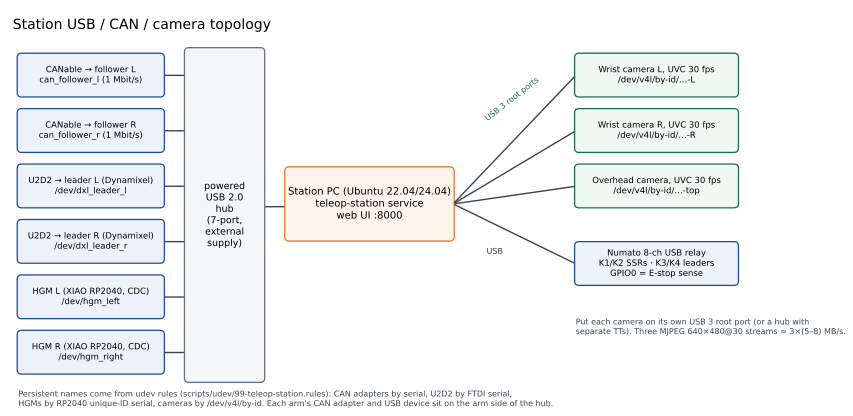

# Electronics: HGM board and station power and safety

Schematic sources are Python ([schemdraw](https://schemdraw.readthedocs.io)) in
`hardware/electronics/src/`. To regenerate everything:

```bash
python hardware/electronics/src/hgm_board.py      # HGM sheets 1–3
python hardware/electronics/src/station_power.py  # station power + USB/CAN topology
python hardware/electronics/src/protoboard.py     # v0 protoboard placement
python hardware/electronics/src/bom_md.py         # docs/hardware/bom.md from bom.csv
```

## 1. Haptic Grip Module board

### Sheet ① Servo power


* The servo draws from the **leader's own 5 V Dynamixel bus**, through the spare JST-EH
  port on J6. Only VDD and GND are used; the DATA pin is not connected. The HGM's servo is
  on a *private* bus driven by the HGM MCU, not on the leader's U2D2 bus.
* **F1** (1.5 A PTC) and **D1** (SMBJ5.0A) protect against wiring faults and transients.
  The XC330's absolute maximum is 6 V.
* **Q1** (AO3401A P-MOSFET) is a high-side switch. **Q2** pulls its gate down when the MCU
  drives `SERVO_EN`. **R4** keeps Q2 off while the RP2040 is in reset, so the servo is
  powered only after the firmware has found and configured it.
* **C1** with R1‖R2 gives a ≈ 5 ms turn-on ramp, which limits inrush into C2 (470 µF).
* **R10/R11** report the bus voltage (÷2) to ADC2, so brown-outs show up in telemetry.

### Sheet ② Half-duplex Dynamixel interface


This is the classic ROBOTIS TTL circuit built with a **74LVC2G241** at 3.3 V. One pin
(`DIR`) drives the active-low OE of buffer 1 and the active-high OE of buffer 2, so exactly
one direction is enabled at a time. LVC inputs and Hi-Z outputs tolerate 5 V, so a 5 V
servo driving the bus can't hurt the RP2040. The firmware drops `DIR` as soon as
`Serial1.flush()` returns, which is after the last stop bit has left the shift register.

### Sheet ③ MCU, encoder and buttons


The full pin table and point-to-point netlist are in
[`hardware/electronics/pinout.md`](../../hardware/electronics/pinout.md).

**v1.1 haptic driver (U3, same sheet).** A DRV2605L module drives the Ø8 coin LRA in the
trigger blade. It sits on its own I²C bus (I2C0, D2/D3, 4.7 k pull-ups, 400 kHz) because
the DRV2605L supports Standard/Fast mode only, while the AS5600 runs at 1 MHz (Fast-mode
Plus) on I2C1. VSENSE moves to D0 (ADC0), and the thumb buttons move to D1 and D10. VIN
and EN go to 3V3, with 10 µF of bulk at the module. The LRA draws ≈ 70 mA peak during a
cue, from the XIAO's 3V3 (USB-powered); that is well inside its budget. Firmware 1.1.0
expects this map; v1.0 boards keep firmware 1.0.0. The protoboard layout drawing
(`protoboard_layout`) still shows the v1.0 placement, so place U3, R12, R13 and J4 in the
free area at the board end.

### v0 build on protoboard


The VSSOP-8 buffer and the SOT-23 transistors go on cheap breakout adapters. The XIAO
sits at the bottom end so its USB-C lines up with the opening in the grip. The board
slides into the rails in the servo-half grip.

## 1b. Fingertip sensor (FGS) board

One board per follower gripper, in a printed enclosure on the gripper's motor can: a XIAO
RP2040, an ADS131M02 (2-channel, simultaneous 24-bit ΔΣ, PGA 128, 4 kSPS), an 8.192 MHz
oscillator, TPS7A2033 (AVDD) and TPS7A2018 (bridge excitation, EN on D1) LDOs, RC input
filters, and two JST-SH bridge connectors. Total draw ≈ 40 mA from USB.

* **Excitation at 1.8 V.** At gain ≥ 8 the ADS131M02 inputs must stay at or below
  AVDD − 1.8 V (1.5 V). A 1.8 V bridge sits at 0.9 V common mode.
* **Noise budget.** 1.20 µV rms input-referred at G = 128, OSR 1024 (datasheet). With a
  bridge output of 0.947 mV per 100 N, that is 0.127 N rms per sample, 0.028 N rms at the
  500 Hz telemetry, and a 0.054 N slip-band floor (firmware tests).
* **Headroom.** Full scale ±9.375 mV ≈ 990 N, so the ADC never clips before the gripper's
  stall force.

Pin map, connectors and bridge wiring are in
[fingertip-sensor.md §7](fingertip-sensor.md#7-electronics); parts are in the BOM's FGS
section. A schematic sheet in the `hgm_board.py` style is still to be drawn: the netlist
in §7 is complete.

## 2. Station power and safety



**Design intent:** software can switch power, but only hardware can **remove** it in an
emergency.

| Element | Choice | Why |
|---|---|---|
| Follower power switch | **DC SSR (Crydom D1D20)** in each 24 V line | Switching DC to a motor load arcs relay contacts; a MOSFET SSR has no contact wear and switches cleanly |
| SSR command | 24 V → 0.5 A fuse → **E-stop NC** → **Numato relay contact** → SSR input | The relay carries only ≈ 10 mA. The E-stop is in series, so it overrides software. |
| E-stop | Mushroom, twist-release, **NC contacts with direct opening action** (IEC 60947-5-5) | NC1/NC2 cut each follower's SSR loop; NC3 feeds GPIO0 for state sensing |
| E-stop sensing | NC3 between Numato GPIO0 and GND with a 10 k pull-up | Released = low. Pressed or wire broken = high, so the station shows E-STOP (fail-safe). |
| Inductive / regen energy | **SMDJ28A** TVS at each arm input | A back-driven arm can lift its bus when the supply is cut |
| Leader buses | K3/K4 switch each leader's 5 V (fused 5 A) | Lets the station power-cycle a leader bus and its HGM servo |
| Relay controller | **Numato Lab 8-channel USB relay** (USB CDC, ASCII: `relay on 0`, `gpio read 0`) | No driver to install, and it has GPIO inputs; the Waveshare Modbus POE ETH relay is the Ethernet option |

**Power-cycle sequence** (implemented by the station service):

1. Ease the follower to its rest pose (2 s).
2. Disable the motors.
3. Open K1/K2.
4. Wait ≥ 3 s, so the DM motor drivers' bulk caps discharge and the CANable sees the bus
   go away.
5. Close K1/K2.
6. Wait for the CAN interface to come up again.
7. Re-initialise through i2rt.
8. Re-check the joint state.

**Stop category.** The E-stop is category 0 (power removed). An unpowered YAM is limp and
sags under gravity. Teach operators to park low before pressing it, and keep the area
below the arms clear. A category-1 stop (controlled stop, then power off) is a software
feature of the station (`control/estop` first commands a damped hold).

## 3. USB / CAN topology



* Put **cameras on separate USB 3 root ports.** Three MJPEG 640×480 at 30 fps streams use
  about 15–25 MB/s together. On one shared USB 2.0 hub they drop frames.
* **Arm-side devices** (CANables, U2D2s, HGMs) are low-bandwidth and share one powered
  hub, which should have its own supply so it doesn't back-feed the PC.
* **Persistent names** come from udev (`scripts/udev/99-teleop-station.rules`): CANables
  by serial → `can_follower_l/r`, U2D2 by FTDI serial → `/dev/dxl_leader_l/r`, HGM by
  RP2040 unique ID → `/dev/hgm_left/right`, cameras by `/dev/v4l/by-id`.

## 4. Grounding and cable routing on the arm

* **Grounds.** One star point at the station DIN rail ties the 24 V returns, 5 V returns
  and USB/PC ground together. USB grounds of every device are common through the PC,
  which is fine at these frequencies. Do not add a second ground strap along the arm.
* **HGM cables along the leader.** The USB-C lead and the 3-pin J6 lead run together in
  one braided sleeve, clipped at every link with printed clips. Leave a 60 mm service
  loop at J4–J6 so roll and pitch don't tug the cable, and check full ±180° J6 roll
  before you tie it down.
* Use a high-flex silicone USB-C cable. Standard PVC cables fatigue at the wrist within
  weeks.
* Keep the 4 Mbps DXL line (J2) short (< 15 cm, it is inside the handle). Long leads need
  2 Mbps.
