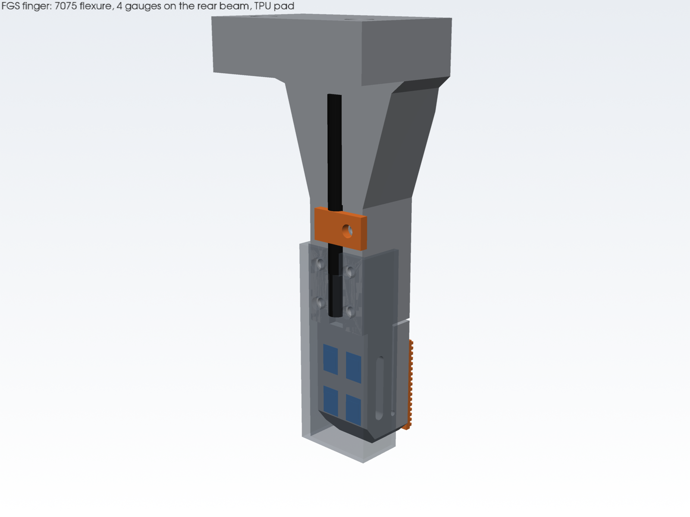

# Follower fingertip sensor (FGS): design report

The FGS replaces the two stock fingers of the I2RT `linear_4310` gripper with fingers
that measure the **normal force on each jaw pad** (0 to the gripper's full force) and a
**slip/vibration band** (60–400 Hz). The station uses these to drive the operator's
trigger: the slow channel (force) through the series-elastic trigger, and the fast channel
(contact onset, slip) through the trigger's vibrotactile cue. The gripper is never limited
by the sensor. It is elastic up to the gripper's stall force, so a full squeeze uses the
full motor force and the station still sees the true number.


| | |
|---|---|
| CAD source | `hardware/cad/fgs/` (`fgs_params.py`, `fgs_parts.py`, `fgs_build.py`, `fgs_fea.py`) |
| Outputs | `hardware/cad/fgs/out/` (`step/`, `stl/`, `fgs_assembly.step`, `renders/`, `checks.md`, `fea.json`) |
| Firmware | `hardware/firmware/fingertip/` (prebuilt UF2 in `prebuilt/`) |
| Protocol | [haptic-protocol.md](../protocol/haptic-protocol.md) v1.1: FINGERTIP `0x91`, params 20–26, commands 1–5, `INFO.hw_rev = 0x11` |
| BOM | [bom.md](bom.md), section "FGS fingertip sensor" |

## 1. Requirements and result

| Requirement | Target | Design | Evidence |
|---|---|---|---|
| Range per jaw | 0 to ≥ 80 N | linear to **≥ 500 N** (elastic to the 480 N stall force); ADC full scale ≈ 990 N | FEA, firmware test |
| Resolution / noise | feel light holds (≈ 0.1 N) | **0.028 N rms** at 500 Hz telemetry; 0.054 N slip-band floor | firmware test with the ADC's datasheet noise |
| Slip / vibration bandwidth | ≥ 400 Hz | slip band 60–400 Hz (–3 dB), sampled at 4 kSPS; flexure first mode **4.6 kHz** | firmware test, FEA modal |
| Latency | — | 4 ms to 50 % of a force step (2nd-order 100 Hz low-pass + boxcar to 500 Hz) | firmware test |
| Overload | survive the gripper | 500 N uniform: 257 MPa peak (yield 503 MPa, safety 1.96); repeated 0→480 N squeezes: Goodman 0.99 (infinite life) | FEA |
| Grasp geometry | near stock | contact face and tip **unchanged**, stroke unchanged; finger is thicker on the back (15.3 vs ≈ 6 mm at the tip) | `checks.md` |
| Mounting | stock interface | same 2 × M4 holes (21.0 mm apart), same 5 mm under the head (stock screws reused) | measured from the stock meshes |
| Mass | — | 53 g per finger with pad, cover and gauges (stock finger ≈ 38 g); +55 g in total per gripper incl. the electronics | `checks.md` |

## 2. Departures from the initial requirements, and why

1. **No hard overload stop.** The initial requirements called for a compliant pad plus
   overload protection (a stop). A stop needs a ground member level with the pad, and a parallel-guided
   flexure only has ground at one end. A stop at the top of the flexure sits ≈ 28 mm from
   the pad's load line. Once it engages, the remaining force becomes a couple that the two
   beams carry axially (≈ 3.8 kN per beam at 500 N with 3.3 mm beam spacing). That loads
   them harder than the stop saves, and it repeats on every full squeeze. Instead, the
   beams are sized to stay elastic with infinite fatigue life at the gripper's own stall
   force, and the pad sits on a stiff arm whose centre is level with the beam mid-height,
   so a centred grip puts almost no couple on the beams (FEA: ±1.8 MPa). The sensor
   therefore measures the full range, and there is nothing to adjust.
2. **Bridge excitation 1.8 V, not 2.5–3.3 V.** The ADS131M02's absolute input range at
   PGA ≥ 8 is AGND − 1.3 V … AVDD − 1.8 V (datasheet §6.3), i.e. 1.5 V at AVDD = 3.3 V. A
   bridge excited from 2.5 V sits at 1.25 V common mode (0.22 V margin); at 3.3 V it is out
   of range. 1.8 V (common mode 0.9 V) keeps 0.6 V margin. A 2.5 V LDO in the same
   footprint gives 1.39× more signal if the first board shows the margin is fine.
3. **Sensing area.** The pad is 11.5 × 17.4 mm at the fingertip (z −56.4 … −73.7 in the
   interface frame). Contact higher up the finger body bypasses the sensor. The body front
   is 1.5 mm behind the pad surface so the pad touches first.

## 3. Trade study: how to sense jaw force

| Option | Range / overload | Noise, drift | Bandwidth | Packaging | Verdict |
|---|---|---|---|---|---|
| Motor-current estimate (today) | full | friction-dominated, ±3–5 N | < 50 Hz | free | keep as fallback |
| FSR / piezoresistive film under the pad | saturates ~20–100 N, creeps | 10–25 % hysteresis, drifts | ok | thin | rejected: not quantitative |
| Capacitive / tactile array | small range, needs custom front-end | temperature-sensitive | ok | thin | rejected: effort, range |
| Commercial button load cell (e.g. 100 N MEMS) | 1.5–3× overload only | good | ok | 10–13 mm tall stack plus mount | rejected: no overload margin against 480 N |
| 6-axis F/T sensor at the wrist | huge | good | ok | heavy, $$$, sees both jaws summed with the arm | rejected |
| **Strain-gauge flexure in the finger** | sized to the gripper | 0.03 N, temperature-compensated full bridge | flexure mode 4.6 kHz | fits the finger | **chosen** |

Within strain gauges: a **parallel-guided double beam** (all four gauges on one flat,
accessible face) rather than a shear web (gauges inside pockets, 2-element rosettes) or a
binocular (needs a hard stop too). The parallelogram makes the output independent of where
on the pad the load sits to first order (FEA: −8 % for a load on the top 2 mm, +7 % on the
bottom 2 mm, −1 % centred).

## 4. Stock interface (measured, not assumed)

Measured from `gripper.stl`, `tip_left.stl`, `tip_right.stl` and `linear_4310.xml` in the
i2rt repository, after applying the MJCF body and geom transforms. The stock MJCF tip mass
(71.0 g) over the mesh volume (52.3 cm³) implies 1.36 g/cm³: the stock tips are plastic.

| Item | Value |
|---|---|
| Interface frame | origin midway between the M4 holes on the finger flange top face; at q = 0 the left origin is (−2.21, −17.11, −70.5) mm in the gripper frame |
| Right finger | the left finger turned 180° about the gripper z axis (the stock meshes match within 0.5 mm), so **both fingers are the same part** |
| Fasteners | 2 × M4 SHCS from below, 21.0 mm apart, 5 mm of flange under the head |
| Contact face | interface y = +17.6 mm; tip bottom z = −74.2 mm; tip centre x = +2.21 (puts both pads on gripper x = 0) |
| Stroke | 0–47.5 mm per finger (joint7/joint8), opening = 2q |
| Gripper body | rail housing ±32.5 × ±51 mm, z −60 … −46; motor can Ø57, z −46 … +10.5 |
| Stock finger below the interface | 27.8 cm³ ≈ 38 g |

At q = 0 the stock tips overlap in the MJCF (423 mm³). The FGS pads meet in the same
place. The real gripper closes until the jaws touch.

## 5. Mechanical design



**fgs_finger** is one 7075-T6 part per jaw, machined from 12 mm plate:

* **Flange** (z 0 … −9): the stock bearing area in y, 33 mm wide. Two Ø4.5 holes, Ø8
  counterbores from below, 5.0 mm under the head. The web hangs from the front part of the
  flange only, so the screw and hex-key columns stay open from below.
* **Web and neck** (z −9 … −51.85): a tapered web into a 12 × 12.6 mm neck. Bending
  stress at 500 N, from the CAD sections, is at most 58 MPa (`checks.md`). The cable runs
  in a 3.2 × 1.6 mm channel on the neck back.
* **Flexure** (wire-EDM profile through x): ground block (5 mm), two beams 2.20 × 12 mm,
  12 mm long, 2.0 mm apart, with full-round slot ends (R1.0); a 0.5 mm gap with a R0.5
  keyhole separates the front beam from the **arm**. The arm (4.2 mm) and the floating
  block form the rigid moving part, and they carry the pad.
* **Gauges**: 4 × BF350-3AA on the back face of the rear beam, two at each end (grid
  centre 2.0 mm from the beam root, x = ±2.75 from the centre line).

**fgs_pad** is printed TPU 85A, a 1.0 mm base with 0.5 mm ridges at 1.0 mm pitch running
across the finger. Like a fingerprint, the ridges turn slip into vibration in the slip
band. **fgs_gauge_cover** (PETG) is screwed to the neck back with 2 × M2 and clears the
gauge face by 1.5 mm. It must never touch the beam or the floating block. **fgs_cable_clip**
holds the cable at the cover entry.

**Changes from stock:** contact face, tip, stroke and pad position are unchanged. The
finger is thicker on the back (15.3 mm at the tip vs ≈ 6 mm) and narrower (12 mm sensing
width vs 11.6–25 mm stock), and the flange is narrower (33 vs 68 mm). Interference against
the stock gripper body and carriages at q = 0, 23.75 and 47.5 mm: none apart from the
intended pad-to-pad contact at q = 0 (`checks.md`).

## 6. Calculations

### 6.1 Flexure (analytic first pass, then FEA)

For a guided double beam each beam carries F/2 with end moments F·L/4:

σ_b = 1.5 F L / (b t²) = 1.5 · 100 · 12 / (12 · 2.2²) = **31 MPa at 100 N** (nominal) → ε = 432 µε.

The 2D plane-stress FEA (`fgs_fea.py`, quadratic triangles, ≈ 144 k elements, converged
to 0.01 %) includes the neck, the blocks, the round slot ends and the keyhole:

| Quantity (per 100 N, uniform on the pad) | FEA |
|---|---|
| Stiffness | **4277 N/mm** (23 µm at 100 N) |
| Gauge-averaged strain, top / bottom pair | −310 / +215 µε |
| Full-bridge output, GF 2.0 | **0.526 mV/V** |
| Peak von Mises (root fillets) | 51 MPa → 257 MPa at 500 N |
| Axial stress at the beam mid-height (couple) | ±1.8 MPa (centred), ±8 MPa (edge loads) |
| First modes | 4577, 6286, 19 324 Hz |


The bottom pair reads less than the top pair because the floating block, shortened by the
tip chamfer, is not perfectly rigid. The bridge uses the difference, so this only costs
sensitivity.

### 6.2 Overload and fatigue

* 500 N uniform on the pad: 257 MPa peak, so the safety factor on yield is 1.96.
* Repeated 0 → 480 N squeezes (the stall force, e.g. the operator squeezing the empty
  gripper shut): σ_a = σ_m = 123 MPa. Goodman: 123/159 + 123/572 = **0.99**, so the life
  is infinite, just.
* Worst-case point load on the **top 2 mm edge** of the pad at 500 N: 519 MPa local peak
  at the gap keyhole. That is local yield at the notch surface, not collapse. It needs a
  sharp object on the pad's upper edge at full stall force. The finger body above the pad
  is recessed by 1.5 mm, so such a contact is unlikely. Open item: a 1 mm chamfer on the
  pad's top edge and a 0.5 mm thicker arm, when the next revision allows 0.5 mm more
  finger thickness.

### 6.3 Sensor stiffness vs jaw compliance

In series per jaw: flexure 4277 N/mm, pad (TPU 85A, E ≈ 15 MPa, 1.5 mm, 200 mm² full
contact) ≈ 2000 N/mm, finger body ≫ 10⁴ N/mm, stock finger plastic (removed). At 100 N the
flexure adds 23 µm of jaw travel and the pad ≈ 50 µm. This is negligible against the
gripper's position control (the station's force regulation sees a slightly softer jaw), and
the flexure's 4.6 kHz mode keeps it far above the force loop and the slip band.

### 6.4 Resolution and noise

* ADC: ADS131M02, PGA 128 (±9.375 mV), OSR 1024 at 8.192 MHz → 4 kSPS, 1.20 µV rms
  input-referred (datasheet Table 7-1).
* Sensitivity: 0.526 mV/V × 1.8 V = 0.947 mV per 100 N → **1.18 × 10⁻⁴ N/count**
  (firmware default `scale`, replaced by calibration). Full scale ≈ 990 N, so the ADC
  never clips before the gripper's stall force.
* Raw noise 1.20 µV ≙ 0.127 N rms per 4 kHz sample. After the 100 Hz Butterworth and the
  boxcar to 500 Hz: **0.028 N rms**. Slip-band floor (60–400 Hz RMS, τ 8 ms): **0.054 N**.
  The test applies the datasheet noise to the real firmware pipeline.
* Temperature: the full bridge on one face of one beam cancels apparent strain to first
  order. Excitation drift (LDO, ≈ 50 ppm/K) is a gain error of < 0.1 % per 20 K.

### 6.5 Slip band rationale

Incipient slip and stick-slip produce bursts of micro-vibration at roughly 50–500 Hz; the
human fast-adapting (Pacinian) channel peaks around 200–300 Hz. The band is 60–400 Hz:

* **60 Hz high-pass, 4th order.** It has zero steady-state response to a force ramp, so a
  firm squeeze doesn't read as slip. In the test a 100 N / 200 ms squeeze leaves
  0.003 N in the slip channel mid-ramp, and 0.2 N for a few ms at the ramp's corners. It
  also rejects arm motion and grasp dynamics: −60 dB at 10 Hz.
* **400 Hz low-pass, 2nd order**, well below Nyquist (2 kHz) and the flexure mode (4.6 kHz).
* **RMS with an 8 ms time constant.** A 0.3 N rms 250 Hz burst is detected (> 0.15 N)
  within 6 ms (test).
* The station should gate slip cues on gripper velocity ≈ 0. Closing and opening the jaws
  excites the band too, which is useful for contact onset (TAP).

### 6.6 Latency

Force channel: ADC sinc³ ≈ 0.4 ms, 100 Hz Butterworth ≈ 2.3 ms group delay, boxcar 1 ms,
USB ≤ 1 ms. The test measures 4 ms from a step to 50 % in the 500 Hz telemetry.

## 7. Electronics

```
 bridge A (left jaw) ─JST-SH 4─┐                        ┌─ USB-C → station hub
 bridge B (right jaw) ─JST-SH 4─┤ RC filters → ADS131M02 ─SPI─ XIAO RP2040
                                │      ↑ CLKIN 8.192 MHz osc.
           TPS7A2018 1.8 V ─────┘ EXC+ (EN = D1)   TPS7A2033 3.3 V → AVDD
```

| XIAO pin | GPIO | Function |
|---|---|---|
| D6 | GP0 | ADC /DRDY (input) |
| D7 | GP1 | ADC /CS |
| D8 | GP2 | SPI0 SCK |
| D10 | GP3 | SPI0 MOSI → DIN |
| D9 | GP4 | SPI0 MISO ← DOUT |
| D0 | GP26 | ADC /SYNC_RESET (10 k pull-up) |
| D1 | GP27 | excitation LDO EN (100 k pull-down) |
| — | GP16/17/25 | onboard RGB LED: red blink = ADC fault, blue = taring, green blink = not calibrated, green = ready |

* **Bridge connectors** J20 (A, AIN0) and J21 (B, AIN1), JST-SH 4: 1 EXC+ (1.8 V),
  2 SIG+, 3 SIG−, 4 EXC− (AGND). The cable shield goes to AGND at the board only.
* **Input filter, per channel:** 1 kΩ 0.1 % in each leg, 10 nF C0G differential, 1 nF C0G
  from each leg to AGND (≈ 7.6 kHz differential corner).
* **Supplies:** AVDD from a TPS7A2033 off VBUS; DVDD from the XIAO's 3V3. CAP pin 220 nF.
  AGND and DGND join at the ADC. The total draw is ≈ 40 mA.
* **Bridge wiring.** Rear-beam back face, viewed from behind: T1/T2 = top pair, B1/B2 =
  bottom pair. A full bridge with one gauge of each pair per half: EXC+ → T1 → SIG+ → B1 →
  EXC−, and EXC+ → B2 → SIG− → T2 → EXC−. Under grip the top pair is in compression and
  the bottom pair in tension, so SIG+ rises, SIG− falls and a grip reads positive. If a
  finger is wired the other way round, calibration simply gives a negative `scale`; the
  sign lives in the parameter.
* **Build.** A 2-layer PCB of about 30 × 38 mm is the recommended build. On a protoboard,
  put the ADS131M02 on a TSSOP-20 adapter, keep the analog runs under 15 mm and use a
  copper ground pour or tape.

The enclosure (PETG base, lid and clamp ring) clamps on the motor can's +x side, above the
rail housing. Each finger cable leaves the cover top through the clip, runs up past the
carriage on the outboard side, and enters the enclosure bottom with a free loop of about
120 mm for the 47.5 mm stroke.

## 8. Firmware (`hardware/firmware/fingertip/`)

* **Core 1** waits for /DRDY (4 kSPS) and reads both channels in one 12-byte SPI frame
  (8 MHz; output CRC checked). It runs the fixed-point DSP: Q30 biquads with 64-bit
  accumulators, since the M0+ has no FPU. Per channel: a 100 Hz low-pass for force, and a
  60 Hz 4th-order high-pass plus 400 Hz low-pass with squared EMA for slip. It also does
  tare averaging and clip detection, and re-initialises the ADC by itself if samples stop
  for 20 ms.
* **Core 0** handles USB: PING/INFO (`hw_rev 0x11`), SET/GET_PARAM 20–26, COMMAND 1 TARE
  (250 ms average, ACKed when done, value = offset A), 2 SAVE, 3 LOAD_DEFAULTS, 4 REBOOT,
  5 BOOTSEL. It sends FINGERTIP at `telemetry_hz` (500 Hz), and sets
  `force = (mean − offset) · scale` and `hf = RMS · |scale|`.
* **Status bits:** ADC_OK (initialised and samples arriving), CAL_VALID (both scales set
  by calibration), OVERLOAD_A/B (|F| > 450 N or the ADC within 5 % of full scale, which
  also flags an open bridge). The bits are sticky for one telemetry interval.
* **Host tests** (`make -C hardware/firmware/fingertip/test/native`): 102 checks. They
  cover the vectors, Q30 vs double reference (≤ 2 counts), frequency response at 8
  frequencies, full-scale overflow, ramp rejection, datasheet-noise floor, slip
  detection, latency, tare, flags, parameter rules and the ADC frame codec.
* **Build:** RAM 4.2 %, flash 5.6 %. Per-sample cost ≈ 35 µs of the 250 µs period on
  core 1 (estimated from the disassembly). `loop_us_max` reports the real figure.

## 9. Calibration with known weights

Do this once per finger after the coating has cured, and again after any gauge repair.

1. Unbolt the finger (2 × M4) and clamp its flange in a vice, pad facing **up**,
   level. Plug in the FGS board and let it warm up for 10 min.
2. **TARE** (COMMAND 1) with nothing on the pad.
3. Put a flat 10 mm aluminium puck with a thin rubber face on the pad centre. Add masses
   of 0.5, 1, 2, 5 and 10 kg (4.9–98 N) and note the raw mean force each time. Read it with
   scale = 1 (SET_PARAM 20/21 = 1.0e-4 temporarily, then divide).
4. Fit F = s · reading through zero (least squares). Linearity should be better than
   0.5 % FS and hysteresis (loading vs unloading) better than 0.3 %. Larger values mean a
   badly bonded gauge.
5. SET_PARAM 20 (A, left jaw) / 21 (B, right jaw) = s, then SAVE (COMMAND 2). CAL_VALID
   comes on when both are set.
6. Refit the finger. At each station start-up, with the jaws open and nothing touching,
   send TARE. The station does this automatically at Start Arms, and warns instead if the
   jaws are closed.

Cross-check: close the gripper on a calibrated luggage scale or force gauge between the
pads. Both channels should read the same force within 2 %.

In place on the arm, the station's wizard (Calibrate → Follower fingertip sensors) zeroes
the pads, checks each one against a known weight and stores a per-pad trim gain in
`calibration/fingertips_<side>.yaml`. That trim sits on top of the bench scale above, so
rerun the wizard after refitting a finger rather than repeating the bench calibration.

## 10. Manufacturing and assembly

1. **Machining (shop).** Material 7075-T6 plate 12 mm. 3-axis CNC for the flange, web
   and neck; then wire EDM through x for the flexure profile (beams 2.20 ±0.01 mm, slot
   2.00, gap 0.50, R1.0 slot ends, R0.5 keyhole; start hole for the slot); tap the 5 ×
   M2 holes. Deburr; no anodising on the gauge face (or mask it). Send
   `hardware/cad/fgs/out/step/fgs_finger.step`. Both fingers are identical.
2. **Gauges** (per finger, about 1 h plus cure):
   1. Abrade the rear-beam back face with 400 grit, then degrease. Mark the grid centres
      2.0 mm from each beam root, ±2.75 mm from the centre line.
   2. Bond the 4 gauges with gauge cyanoacrylate under thumb pressure through PTFE film
      (60 s).
   3. Glue a terminal pad on the neck back next to the cable-channel end.
   4. Jumper the gauges with 36 AWG wire to form the bridge in §7, and solder the
      4-core cable.
   5. Check each arm: 350 Ω ±1 %, bridge output < 2 mV/V, insulation to the finger
      > 1 GΩ (or OL on a 200 MΩ range).
   6. Coat the gauges thinly. Keep the coating out of the slot and the gap.
3. **Pad:** prime and glue the TPU pad on the arm/floating-block front (CA + primer).
   Keep glue out of the 0.5 mm gap.
4. **Cover and clip:** 2 × M2 × 6 for the cover, 1 × M2 × 6 for the clip. Check that
   the cover does not touch the beam or the floating block: push the pad and watch the
   live force; it must return to zero.
5. **Fit to the gripper** with the stock M4 screws through the counterbores from below
   (3 mm hex key). Tighten them to the stock torque.
6. **Enclosure:** fit the board, then clamp the base and clamp ring around the motor can
   (2 × M3 × 12). Route the cables with their service loops, then cycle the gripper
   fully open and closed to check that no cable is pinched.

## 11. Verification summary

| Check | How | Result |
|---|---|---|
| Interference with the stock gripper | mesh booleans (manifold3d) vs the i2rt body and carriages at 3 openings | none except the intended pad contact at q = 0 |
| Mass | CAD volume × density | 53.2 g per finger; +55 g per gripper in total |
| Finger body strength | CAD sections at 6 heights, 500 N | ≤ 58 MPa |
| Flexure | 2D FEA, convergence-checked | §6.1, §6.2 |
| Firmware DSP and protocol | 102 host tests | pass |
| Firmware build | PlatformIO, arduino-pico | clean, UF2 in `prebuilt/` |
| Protocol vectors | shared JSON, C++ and Python | FINGERTIP and FGS INFO packets match |

## 12. Open items (VERIFY)

* BF350-3AA gauge factor of the lot, and the backing size (trim it to 5 mm).
* ADS131M02 register map details (ID 0x22xx, GAIN 0x04 code 7, output-CRC coverage). The
  boot LOG prints the ID and the GAIN read-back. The firmware disables the CRC check (and
  logs it) if no frame ever matches.
* The 8.192 MHz oscillator part number; any 3.3 V CMOS 8.192 MHz oscillator with ±50 ppm
  will do.
* Stock M4 screw length and tightening torque (reuse the stock screws).
* The pad top-edge local-yield case (§6.2) under real objects.
* The noise figure on hardware (the firmware reports it): expect ≈ 0.03 N rms at 500 Hz.
