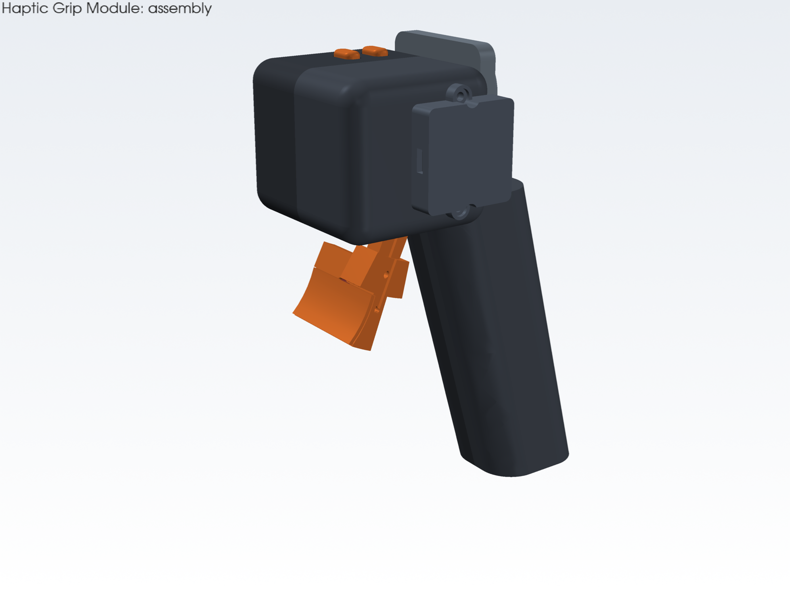
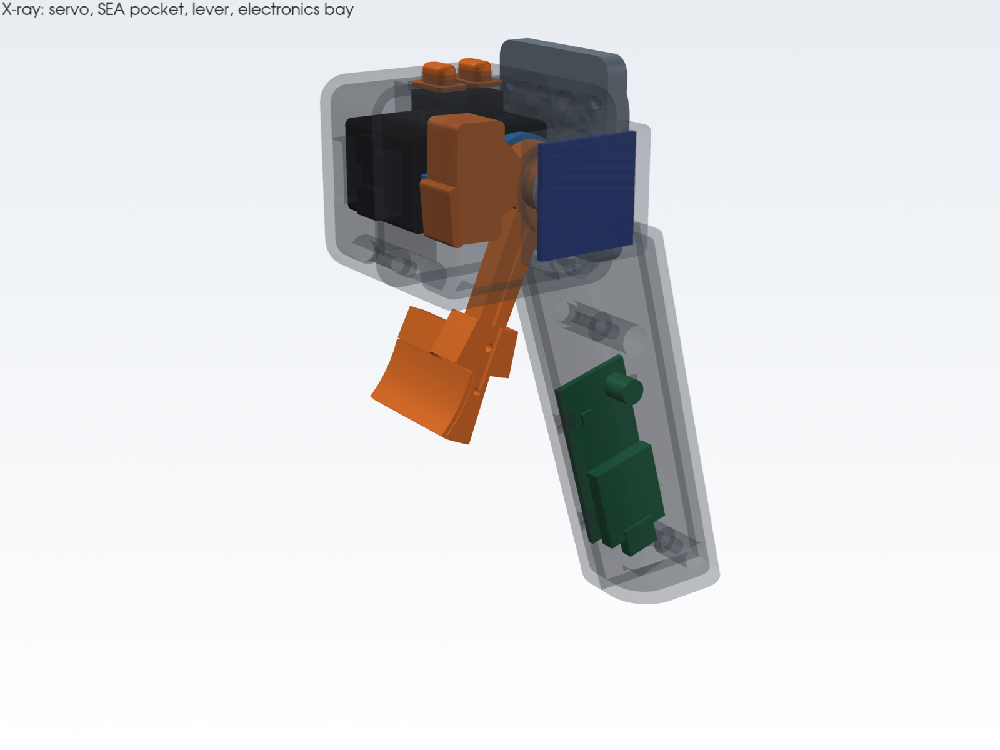
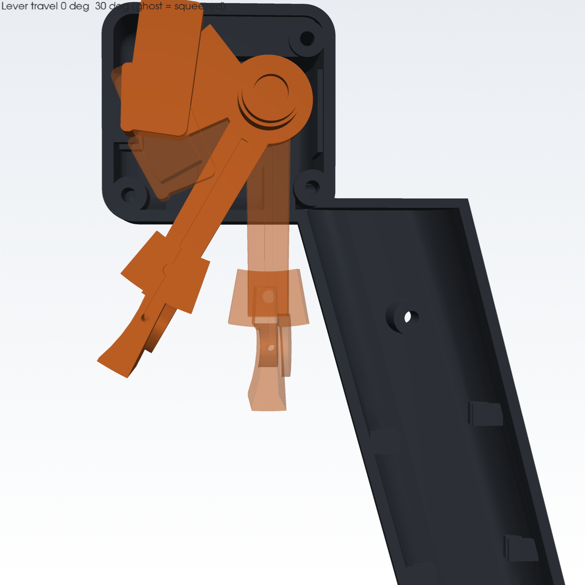
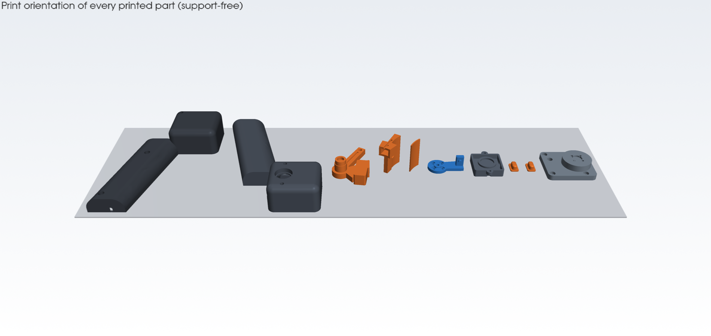

# Haptic Grip Module (HGM): design report

The HGM replaces the leader arm's trigger handle with a series-elastic trigger. The
operator **feels the follower gripper's grip force** at the finger, and the station
**measures how hard the operator squeezes**. It is a single bolt-on handle with one USB-C
cable and one 3-pin lead to the leader's J6 servo.

| | |
|---|---|
|  |  |
| Assembly (encoder side) | Section through the spring pack at 12 N |

Every number here comes from `hardware/cad/params.py` and is re-checked by
`python hardware/cad/build.py`, which writes [`checks.md`](../../hardware/cad/out/checks.md).
Interactive 3D model: open `hardware/cad/viewer/index.html` in a browser. It has an
explode slider, trigger angle φ and spring deflection δ.

---

## 1. Requirements

| # | Requirement | Target | Achieved (design) |
|---|---|---|---|
| R1 | Render follower grip force at the finger | 0–12 N continuous, 15 N peak | 0–15 N (overload stop at 17.1 N) |
| R2 | Sense operator squeeze force | ±0.5 N, ≥ 200 Hz | ≈0.11 N per count, 500 Hz telemetry |
| R3 | Keep the leader light | ≤ 130 g module | **128 g** (estimate, §8) |
| R4 | Trigger travel and feel like the current handle | ~30°, light return spring | 30° (23.6 mm at the pad), 1.2 N + 1.5 N/stroke default |
| R5 | Stable against a geared, position-controlled servo | no chatter at contact | series elastic element, §5 |
| R6 | Fail safe | passive when the PC dies, no stuck-closed trigger | watchdog → SPRING; MCU reset → servo unpowered |
| R7 | Printable on a hobby FDM printer, no supports | ✔ | all parts support-free (§9) |
| R8 | Buttons for save/abort/record | 2 thumb buttons | 2× Omron D2F-01, bindable in the UI |

## 2. Why series-elastic? (trade study)

| Option | Senses F_op | Renders F_fb | Stability with geared servo | Robustness | Cost | Verdict |
|---|---|---|---|---|---|---|
| Servo current only (today) | ✗ gear friction ±0.1 N·m swamps it | weak, open loop | ok | ok | $0 | rejected |
| FSR on the trigger face | ±25 %, drifts, needs contact area | ✗ | — | wears | $8 | rejected |
| Strain-gauge load cell + 24-bit ADC in the linkage | ✔✔ | ✔ | ✗ stiff sensor + stiff gear train = high loop gain → contact chatter | fragile overload | $15 | backup |
| **Series elastic (spring + two encoders)** | ✔ ≈0.1 N | ✔ closed loop | ✔✔ spring caps loop stiffness, no amplifier | overload stop, no drift | ~$10 | **chosen** |
| Direct-drive BLDC / voice coil | ✔✔ | ✔✔ | ✔✔ | ✔ | $60–120 + FOC driver | v2 candidate |

A series elastic actuator (SEA; Pratt & Williamson, IROS 1995) puts a known spring between
the actuator and the load. Force becomes a *position* measurement (spring deflection), and
force control becomes *position* control of the spring's far end. Dynamixels are very good
at position control.

## 3. Mechanism

```
          finger ─▶ blade (r_f = 45 mm)
                        │
          lever ── hub ─┴─ 6700ZZ in the +Y wall ── magnet ⟶ AS5600 (θ_l)
            │ pocket: backstop | window | spring Ø5.5 × 15 | floor spigot
            │                     ▲ tab + spigot
          drive disc ─────────────┘  (pin Ø3 → MR63 in the lever hub)
            │ bolted to the horn
          XC330-M288-T (θ_s, current-based position mode)
```



* **One axis.** The lever hub (Ø10 in a 6700ZZ) and the servo output are coaxial. The
  drive disc carries a Ø3 dowel that runs in an MR63 in the lever, so the two halves of
  the SEA share a pivot without adding friction to the force path.
* **Spring pack.** The disc's tab sits in a window in the lever. Its back face rests on
  the **backstop** (preloaded 0.3 mm). Its front face spigot holds one compression spring
  whose other end sits on a spigot in the pocket floor. Deflecting the spring rotates the
  disc *relative to* the lever by δ.
* **Hard stops.** The **overload rim** stops the tab at δ = 13.2°, before the spring goes
  solid. The lever's **open/closed stops** are the ends of the floor slot. All four stops
  are checked numerically (§10).
* **Geometry trick.** The window is cut as the exact swept envelope of the tab over
  0…13.2°. The tab face is tilted to the mid-deflection orientation, so the spring seat
  tilt stays within ±6.6° and the lateral drift of the spring end within ±0.13 mm.
* **Finger blade** is a separate, swappable part (one M2 screw), so pad shape and length
  can change without reprinting the lever.



## 4. Spring, stiffness, force and resolution

Spring (music wire, ASTM A228), closed & ground ends:

| d | OD | D (mean) | n_active | n_total | L₀ | solid | rate k_s |
|---|---|---|---|---|---|---|---|
| 0.9 mm | 5.5 mm | 4.6 mm | 8.5 | 10.5 | 15.0 mm | 9.45 mm | **7.86 N/mm** |

`k_s = G d⁴ / (8 D³ n) = 79.3 GPa · 0.9⁴ / (8 · 4.6³ · 8.5) = 7.86 N/mm`

The spring axis is tangent to a circle of radius **R_s = 20 mm** at mid-deflection. So:

* Torsional stiffness: **k_θ = k_s R_s² = 3.144 N·m/rad** (0.0549 N·m/°).
* At the finger: **1.22 N per degree** of deflection, or k_θ / r_f² = **1.55 N/mm**.
* Spring compression vs δ: x(δ) = x_p + R_s [sin(δ − δ_m) + sin δ_m], with δ_m = 6.6°.
  This is linear within 0.7 % over the range, and the residual is absorbed by calibration.

| Load case | δ | Spring length | Spring force | Finger force |
|---|---|---|---|---|
| Preload (tab on backstop) | 0° | 14.70 mm | 2.36 N | 1.05 N (τ_p = 0.047 N·m) |
| Default cap | 9.0° | 11.57 mm | 27.0 N | 12.0 N |
| Peak render | 11.5° | 10.71 mm | 33.8 N | 15.0 N |
| Overload rim | 13.2° | 10.10 mm | 38.5 N | **17.1 N** |
| Solid | — | 9.45 mm | — | (never reached: 0.65 mm margin) |

**Stress.** The Wahl factor is 1.303 (index C = 5.11). τ = 8FDK_w/(πd³) = **806 MPa** at
the overload rim. A228 Ø0.9 mm has S_ut ≈ 2.3 GPa, so the static allowable is ≈ 0.45 S_ut ≈
1040 MPa and **SF = 1.29 at overload**. For fatigue, Zimmerli (unpeened, S_sa = 241,
S_sm = 379 MPa) with Goodman (S_su = 0.67 S_ut) gives infinite life for cycles from preload
up to **11.9 N** at the finger. The 12 N default cap sits at that limit. For multi-million-
cycle duty, cap rendering at 10 N (SF 1.2) or order shot-peened springs. The spring is a
$1.50 consumable.

**Resolution.** Both encoders are 12-bit (1.534 mrad/count). One count of deflection is
3.144 × 1.534 mrad / 0.045 m = **0.107 N**. Quantization noise from two independent
encoders is 0.107/√12·√2 ≈ **0.044 N rms**. AS5600 noise with the fastest filter adds
roughly 0.1 N rms, which the 30 Hz velocity/force filtering reduces. Measure the real noise
floor as the standard deviation of `force_op_n` in TELEMETRY while you hold the lever still
mid-travel.

**Servo torque budget (XC330-M288-T at 5 V, stall 0.93 N·m at 1.80 A):**

| Quantity | Value |
|---|---|
| Torque for 15 N at 45 mm | 0.675 N·m (73 % of stall) |
| Default current limit 1200 mA | ≈ 0.62 N·m (13.8 N); hardware cap in current-based position mode |
| Holding 8 N continuously | 0.36 N·m, ≈ 0.7 A: thermally fine |
| No-load speed | 81 rpm = 8.5 rad/s → 0 → 12 N (9° of deflection) in ≈ 19 ms |
| Firmware haptic slew limit | 300 N/s → 12 N in 40 ms (below what the servo can do) |

**Leader 5 V bus budget.** Six XL330 joints draw about 0.15 A each when idle and light in
current mode. The HGM servo is capped at 1.2 A. That gives ≈ 1.5 A typical and ≈ 4.2 A
worst case, so use a **5 V 6 A supply per leader** (BOM). The JST-EH contacts are rated
3 A. At J6, the spare port carries only the HGM current (≤ 1.2 A). If your leader runs
its joints at high current-mode torque, feed the HGM from its own 5 V lead along the arm
instead of the J6 port.

## 5. Control

### 5.1 Firmware loop (1 kHz, `hardware/firmware/haptic_grip/src/control.cpp`)

```
              F_haptic (host, ≥100 Hz, slew 300 N/s)
                    │
   p, ṗ ─▶ F_des = clamp(spring_min + spring_n·p + F_haptic + b·ṗ, F_pre+0.05, min(max_n, 15 N))
                    │
                    ▼  deflection command
   θ_s* = θ_l − δ₀ − (F_des·r_f − τ_p)/k_θ  − K_i∫(F_des − F_spring)dt
                    │
                    ▼  Goal Position (current-based position mode, I ≤ 1200 mA)
              XC330 internal position loop ──▶ θ_s ──┐
                                                     ├─▶ δ = θ_l − θ_s − δ₀ ─▶ τ_s = τ_p + k_θ δ ─▶ F_spring
   finger ─▶ lever ─▶ θ_l (AS5600) ──────────────────┘
```

* **Position-sourced SEA.** The servo position is commanded as the lever angle minus the
  deflection that produces F_des. With K_i = 0 (default), the force law is feed-forward
  on a measured spring, so its accuracy depends only on k_θ and δ₀, both calibrated.
  K_i (≤ 0.05 rad/N·s) removes residual error in free travel and is frozen on the stops.
* **Measured operator force** F_op = τ_s / r_f is reported while the lever is off the
  open stop. On the stop the finger force is undetermined (0…F_des) and reported as 0.
* **Modes.** OFF (torque off); SPRING (passive return spring, used whenever the host is
  silent); RENDER (+ F_haptic); POSITION (host commands p, for calibration and self-test).

### 5.2 Why it is stable

1. **No force feedback through the gearbox.** The only feedback path is the servo's own
   position loop, which is stable by design. The SEA turns force control into a
   position-tracking problem.
2. **Rendered impedance is bounded by the physical spring.** What the finger feels is the
   virtual impedance *in series with* k = 1.55 N/mm. The default virtual spring
   (1.5 N per 23.6 mm stroke ≈ 0.064 N/mm) is 24× softer than the physical spring, well
   inside the passive region.
3. **Slew-limited, low-passed haptic input.** F_haptic is rate-limited to 300 N/s in the
   firmware and low-passed (20 Hz) on the station. Above the bilateral loop's
   crossover, the lever behaves like a passive spring with damping b·ṗ.
4. **Saturations.** F_des is clamped to [F_preload + 0.05, 15 N]. The servo current limit
   caps torque in hardware, and the overload rim caps spring force mechanically.

### 5.3 Station-side bilateral law (recommended)

Delivering the follower's *force* (not its stiffness) to the finger is what keeps the
bilateral loop well-behaved. The i2rt gripper runs a stiff PD (kp = 20 N·m/rad on the
motor, which is **≈ 94 N/mm** at the jaws). Reflecting that stiffness through the
trigger→jaw mapping (×4.1) would ask for ~390 N/mm × feedback gain at the finger, far
beyond the 1.55 N/mm the SEA can render, and with 10–20 ms of loop delay it chatters.
Use a **contact-relative force command** instead:

```
free space:   gripper position  x* = x_open · (1 − p)                  (i2rt position mode)
contact at p_c (F_grip > F_contact and |v_grip| < v_still, with hysteresis):
              grip-force target  F* = max_grip_n · (p − p_c)/(1 − p_c)  (i2rt force limiter / clog mode)
render:       F_haptic = feedback_gain · LPF_20Hz(F_grip_est)
```

The haptic "spring" the operator feels past contact is then
`feedback_gain · max_grip_n / (stroke left)`. For example, 0.25 · 40 N / 15 mm ≈ 0.67 N/mm,
below the 1.55 N/mm SEA limit, so it is stable. Squeezing deeper grips harder and feels
harder.

> ⚠️ **Do not drive the grip-force target from the measured F_op while also rendering
> F_grip back.** Quasi-statically F_op equals the rendered force, which closes an
> algebraic loop with gain `feedback_gain × input_gain`. At 0.25 × 4 = 1 that loop is
> marginally stable (it drifts), and above 1 it runs away. Record F_op as the
> operator-effort signal and for safety. If you want an F_op-driven mode, keep the gain
> product ≤ 0.5 and low-pass it.

The follower grip-force estimate:
`F_grip = max(0, |τ_g| − τ_c(v)) · G_grip`, with G_grip = motor_stroke / gripper_stroke =
6.57 / 0.096 = 68.4 N per N·m for `linear_4310`. τ_c is the Coulomb friction (≈ 0.05–0.1
N·m, from the gripper-force calibration). A calibration with a luggage scale or load
cell between the jaws replaces the nominal G_grip and τ_c.

## 6. Calibration (the station's trigger calibration wizard runs these steps over the protocol)

| Step | What | How | Writes |
|---|---|---|---|
| 1 | Encoder directions | POSITION mode: command p 0 → 0.2 and check that θ_l and θ_s both increase | `lever_dir`, `servo_dir` (±1) |
| 2 | δ₀ (SEA zero) | `TARE_SEA` with the hand off the trigger. The firmware turns torque off for 0.3 s; the preload seats the tab on the backstop, and it averages θ_l − θ_s over 100 ms. | `sea_zero` |
| 3 | Travel | SPRING mode: read θ_l at rest (open stop), then while the operator squeezes fully (closed stop) | `theta_open`, `theta_closed` |
| 4 | k_θ | Hold the servo (POSITION mode at p = 0.5). Hang 0.5 kg and 1.0 kg from the pad centre (r_f = 45 mm, handle turned so gravity is tangential), or press with a kitchen scale, and record δ. Slope = (F·r_f) / (δ − δ₀). Expect 3.1 ± 0.5 N·m/rad. | `k_theta` |
| 5 | τ_p | Intercept of the same fit (expected 0.047 N·m) | `preload_nm` |
| 6 | Save | `SAVE_PARAMS` (flash); the status bit CAL_VALID is now set | |

The station also stores the calibration in its database and sends it to the module on
connect, so a swapped module is detected by its serial number.

## 7. Failure modes and safety

| Failure | Effect | Mitigation |
|---|---|---|
| Station crashes or USB unplugged | No setpoints | 100 ms watchdog → SPRING mode (passive return); WATCHDOG status bit |
| Firmware hangs | Loop stops | RP2040 hardware watchdog (100 ms) reboots the MCU; the gate drops servo power during reset |
| Servo overload or over-temperature | Dynamixel hardware-error bit | Mode OFF, SERVO_HW_ERROR bit; CLEAR_FAULTS reboots the servo |
| Spring breaks | F_spring ≈ τ_p and the lever floats | Detected when the servo current rises with no deflection (station health check: servo current vs F_cmd) |
| Magnet loose / out of range | Wrong θ_l | AS5600 MD/ML/MH status → MAGNET_FAULT → OFF |
| Operator yanks the trigger | Up to 17 N through the spring, then the rim | Overload rim (13.2°) protects the spring; the gear sees the excess, within XC330 stall |
| 5 V bus short | | 1.5 A PTC (F1); SMBJ5.0A clamps over-voltage |
| Pinch point | Blade closing on a finger | The blade only closes as far as the operator pushes; the servo only ever pushes it **open**, and its force is capped at 15 N |

## 8. Mass budget (from `checks.md`)

| Group | Mass |
|---|---|
| Printed parts (PETG at 0.8 effective density) | 77 g (housing halves 53 g, mount adapter 10.8 g, lever + blade 9.0 g, disc 1.4 g, cover 2.6 g, caps 0.4 g) |
| XC330 + horn | 24 g |
| Bearings, pin, magnet, spring | 3.9 g |
| Electronics (XIAO, AS5600, protoboard, switches) | 11.8 g |
| Screws, inserts, wiring | 11 g |
| **Total** | **≈ 128 g** (target ≤ 130 g) |

Compared with a printed GELLO handle with an XL330 trigger (~70 g), the HGM adds ≈ 60 g
at ~50 mm from J6. If the leader uses counterweights or spring gravity compensation,
re-balance J4–J6 for that extra mass.

## 9. Printing

| Part | Material | Orientation (all support-free) | Notes |
|---|---|---|---|
| housing_servo_half / housing_encoder_half | PETG | split face down | 4 walls, 30 % gyroid, 0.2 mm layers; bearing seat printed vertical for roundness |
| lever | PETG | −Y face (pocket opening) down | 100 % infill around the hub; ream the MR63 seat if tight |
| blade | PETG (or PLA+) | −Y face down | swap shapes freely |
| drive_disc | PETG | horn face down | 100 % infill |
| encoder_cover | PETG | floor down | |
| mount_adapter | PETG | flange down | 5 walls |
| button caps ×2 | TPU 95A | flange down | |
| blade_skin (v1.1) | TPU 95A | inner face down | 1.0 mm shell over the finger zone |



Fits are parametric (`FIT_PRESS` = 0.05 mm, `FIT_SLIP` = 0.20 mm). Print the
`bearing_6700` seat test first if your printer runs tight.

## 10. Verification (automated in `build.py`)

| Check | Method | Result |
|---|---|---|
| Interference over the motion range | OCC boolean intersection of every moving part against every part, on a φ ∈ {0, 10, 20, 30}° × δ ∈ {0, 6.6, 13.2}° grid (1668 pair checks) | **0 collisions** |
| Hard stops actually stop | Distance at each stop ≈ 0, and overlap > 0 at 1° (lever) / 0.5° (SEA) past it | all 4 ✔ |
| Clearance moving ↔ fixed | BRepExtrema minimum distance | ≥ 0.2 mm (stop contacts), ≥ 1 mm elsewhere |
| Spring never goes solid | geometry → length at the overload rim | 10.10 mm vs 9.45 mm solid |
| Wall thickness | opposed-face ray casting on the STLs (6000 samples per part) | p5 ≥ 1.6 mm on every part; lever and blade have < 0.5 % of samples under 1.5 mm. What remains in the housing (3 %) is non-structural: the bearing lip, fillet slivers where bosses meet the inner corner blends, and the front-bottom screw counterbore breaking out of the corner blend (cosmetic) |
| Mass | volume × density × fill | 127.9 g |
| Firmware control law | host-native test (`make -C hardware/firmware/haptic_grip/test/native`) against a lever–spring–servo plant simulation: rest, render equilibrium, push-back, clamps, slew limit, modes | 104 checks pass |
| Firmware builds | PlatformIO, arduino-pico 4.6, Seeed XIAO RP2040 | builds clean: RAM 4.2 %, flash 5.8 %; UF2 in `hardware/firmware/haptic_grip/prebuilt/` |
| Wire protocol | the same vectors (`tests/vectors/haptic_protocol.json`) checked by the C++ codec and the Python codec | ✔ (one known Python COBS edge case, see the report) |

**Values to verify before printing** (marked `VERIFY` in `params.py`): XC330 output-axis
position (10 mm from the rear end), horn diameter, horn bolt circle (11 mm assumed),
AS5600 board size (23 mm), and your leader's J6 horn pattern (see `mount_adapter.py` for
how to measure it).

## 11. Future work (v2)

* Custom 2-layer PCB (the schematic is already in sheets; KiCad port).
* Shot-peened spring and a second spring rate for "heavy" tasks.
* Direct-drive BLDC trigger with FOC (e.g. a 2204 gimbal motor + MT6701), for higher
  bandwidth and renderable stiffness.
* ~~Vibrotactile slip cue~~: done in v1.1 (§12), driven by the follower fingertip sensor.

## 12. v1.1: vibrotactile cues (LRA in the blade)

v1.1 adds the "fast-adapting" half of touch: short cues for contact onset and slip that the
series-elastic loop (bandwidth ≈ 10–15 Hz) cannot render.

**Hardware.** A Ø8 × 3.2 mm coin LRA (≈ 235 Hz, VERIFY the part) sits in a pocket behind
the finger zone of the blade. The pocket is Ø8.3, 3.45 deep, with a Ø12 × 2 mm boss on
the blade back so ≥ 1.5 mm of wall stays. The LRA is mounted on 0.25 mm VHB tape. A
1.0 mm TPU 95A skin covers the finger zone. The leads run through a Ø1.6 hole and the
blade's top groove, along a groove in the lever arm, round the pivot with a slack loop,
and into a slotted strain-relief post on the encoder half. A DRV2605L module drives the
LRA in closed-loop auto-resonance.

**I²C deviation from the protocol text.** The protocol note says the DRV2605L shares the
AS5600 bus. It cannot: the DRV2605L supports Standard/Fast mode only (≤ 400 kHz), and the
AS5600 runs at 1 MHz to keep the 1 kHz loop budget. The driver therefore has its own bus
(I2C0 on D2/D3 at 400 kHz). VSENSE moves to D0, and the buttons move to D1 and D10.
Firmware 1.1.0 expects this map.

**Firmware.**
* CUE (0x07) is fire-and-forget and ignored unless LRA_OK.
* TAP is one 20 ms burst. SLIP is a 15 ms on / 15 ms off train, and each SLIP cue extends
  it. RELEASE is one 12 ms burst at half amplitude. BUZZ is 100/100 ms for 400 ms. A
  `duration_ms` of 0 picks these defaults; the maximum is 2 s, and amplitude 0 stops.
* The DRV2605L is auto-calibrated at every boot (RATED_VOLTAGE, OD_CLAMP and DRIVE_TIME
  derived from the LRA spec) and then runs in real-time-playback mode.
* The cue engine changes amplitude at most once per tick: one 2-byte I²C write, about
  75 µs at 400 kHz.

**Isolation from the force measurement.** Mechanical isolation of the LRA was the
original ask, but it is not physically possible here. The pad carries up to 15 N
statically. A mount soft enough to isolate at 235 Hz would sag millimetres under that
load, and a mount stiff enough to hold the load (e.g. 0.8 g on foam) resonates near
770 Hz, so it amplifies rather than isolates. The isolation is done in the signal domain
instead. An always-on notch at 235 Hz (Q 1.5) on the lever angle costs 1.6° of phase and
0.45 ms of delay at 10 Hz. Host test with the LRA rigidly coupled to the lever
(J = 2·10⁻⁵ kg·m², b = 4·10⁻³ N·m·s, encoder quantisation):

| | force noise during a cue |
|---|---|
| without the notch | 0.055 N rms |
| with the notch (shipped) | **0.022 N rms**, below the 0.044 N quantisation floor |

**Loop timing.** The worst-case modelled tick is 485 µs of the 1000 µs period, with
≤ 1 DRV write per tick, proven by the host tests (`test_loop_budget`).

**Mass.** With the LRA, DRV2605L, leads, skin and boss the module is **130.3 g**
(target ≤ 135 g). Re-checked by `build.py`: 0 collisions over the motion range, all four
stops OK. The new thin walls in the blade are the 1.0 mm skin (by design) and ≈ 1.1 mm
either side of the Ø1.6 lead hole. That hole sits at the finger radius, where the blade's
bending moment is near zero: at 17 N on the blade tip the stress there is ≈ 3 MPa.
