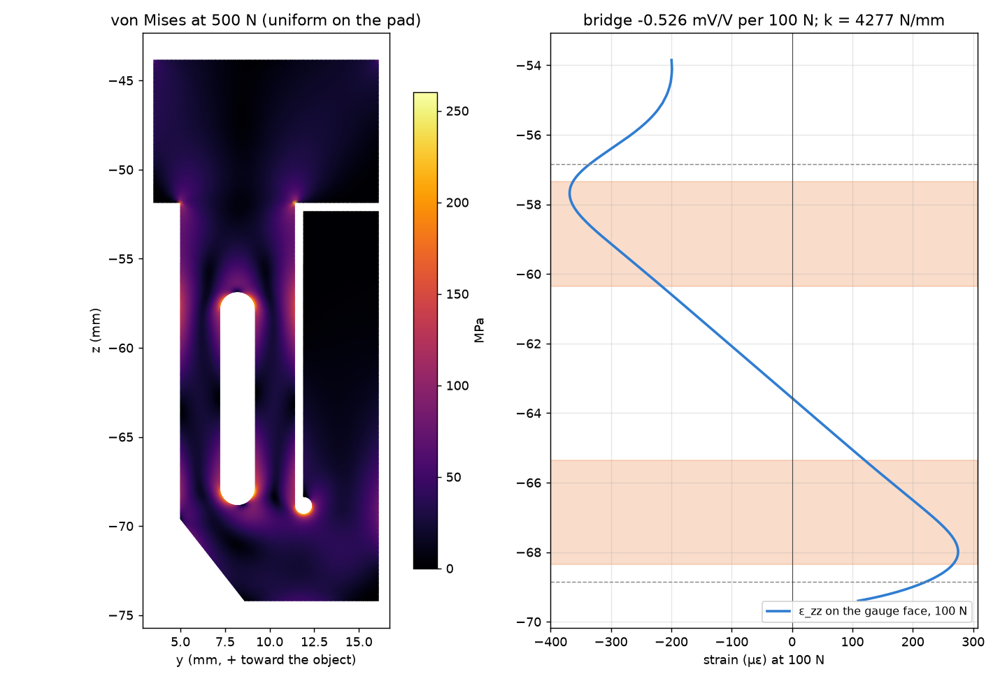

# FGS design checks (generated by fgs_build.py)

Generated 2026-10-20 22:38.

## Parts

| Part | Material | Mass g | BBox mm | Note |
|---|---|---:|---|---|
| fgs_finger | 7075-T6 (CNC + wire EDM) | 45.3 | 33.0 × 22.2 × 74.2 | machined; flexure profile wire-EDM through x |
| fgs_pad | TPU 85A | 0.3 | 11.5 × 1.5 × 17.4 | print ridges up, 0.1 mm layers |
| fgs_gauge_cover | PETG | 1.5 | 15.0 × 8.7 × 36.5 | print outer face down |
| fgs_cable_clip | PETG | 0.1 | 10.5 × 1.5 × 5.5 | print flat |
| fgs_enclosure_base | PETG | 10.2 | 45.1 × 77.2 × 30.0 | print open side up |
| fgs_enclosure_lid | PETG | 2.3 | 3.1 × 34.0 × 30.0 | print outer face down |
| fgs_clamp | PETG | 4.7 | 33.1 × 77.2 × 10.0 | print flat (ring axis vertical) |

## Mass

* Per finger (finger, pad, cover, clip, gauges, cable stub): **53.2 g** (stock finger below the interface ≈ 37.8 g)
* Enclosure, clamp and board: 24.2 g
* Added to the gripper in total: **55.1 g**

## Grasp geometry vs stock

| Quantity | FGS | Stock |
|---|---|---|
| contact face (interface y) | 17.6 mm | 17.6 mm |
| tip bottom (interface z) | -74.2 mm | −74.2 mm |
| stroke per finger | 47.5 mm | 47.5 mm |
| finger thickness at the tip | 15.3 mm | ≈ 6 mm |
| sensing pad (x × z) | 11.5 × 17.35 mm | — |

## Interference with the stock gripper (q = 0, 23.75, 47.5 mm)

Unexpected overlaps: **0**.

* q = 0.0 mm: fgs_pad_left ↔ fgs_pad_right: 95.8 mm³

The stock tips themselves overlap 422.6 mm³ at q = 0 in the MJCF; at q = 0 the pads meet exactly where the stock tips meet (the MJCF tips overlap at q = 0 too); the real gripper stops on contact.

## Finger body bending at 500 N (CAD sections)

| z mm | A mm² | I mm⁴ | M N·m | σ MPa |
|---:|---:|---:|---:|---:|
| -9.5 | 352.2 | 3881.0 | 27.76 | 41.1 |
| -20.0 | 227.5 | 3009.0 | 22.51 | 47.1 |
| -30.0 | 148.6 | 1921.0 | 17.51 | 58.3 |
| -40.0 | 146.1 | 1839.0 | 12.51 | 44.2 |
| -51.35 | 146.1 | 1839.0 | 6.84 | 24.1 |
| -53.85 | 127.2 | 1360.0 | 5.59 | 23.0 |

## Flexure FEA (2D plane stress, P2 triangles)

* 144320 elements, 582640 DOF; convergence: bridge -0.5258 → -0.5258 mV/V
* Stiffness **4277 N/mm**; first modes 4577, 6286, 19324 Hz
* Gauge strain at 100 N: top -310 µε, bottom 215 µε → **0.526 mV/V per 100 N** (GF 2.0)
* Load-position sensitivity (2 mm patch vs uniform): top -8.2 %, centre -0.9 %, bottom 6.6 %
* Peak von Mises in the flexure at 500 N, uniform on the pad: **256.9 MPa** (yield 503; safety 1.96)
* Peak at 500 N concentrated on the top 2 mm of the pad: 519.4 MPa (local, at the gap end)
* Goodman sum for repeated 0 → 480 N squeezes (uniform): 0.99 (< 1 = infinite life)

